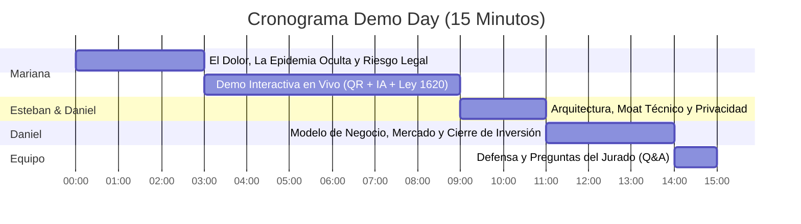

# Guía Maestra y Guión de Pitch: Demo Day (15 Minutos) — SafeVoice

> **Evento:** Demo Day / Presentación ante Inversionistas y Jurado Académico  
> **Duración Total:** 15 Minutos (11-12 minutos de exposición y demo interactiva + 3-4 minutos de preguntas/defensa)  
> **Formato:** Pitch Híbrido (Diapositivas visuales de alto impacto + Demostración interactiva en vivo con código QR)  
> **Despliegue de Producción Activo:** `http://157.137.205.82` (Oracle Cloud Infrastructure)  

---

## 👥 1. Asignación de Roles del Equipo Fundador

| Integrante | Rol en el Pitch | Responsabilidad Principal |
| :--- | :--- | :--- |
| **Mariana Arbeláez** | **Líder de Negocio y Estrategia** | Apertura impactante, definición del problema, dolor legal de los colegios, modelo B2B SaaS, tamaño de mercado y cierre de inversión (*The Ask*). |
| **Esteban Álvarez** | **Líder de Frontend y Experiencia UX** | Conducción de la interacción en vivo con el jurado mediante Código QR, recorrido del estudiante y mapa de calor preventivo. |
| **Daniel López** | **Líder de IA, Backend y Arquitectura Cloud** | Demostración del triaje en tiempo real con Machine Learning (3.5 ms), Asistente Legal Ley 1620, generación de Acta PDF, patrón Proxy y cifrado Fernet AES-128. |

---

## ⏱️ 2. Cronograma Minuto a Minuto



---

## 📑 3. Estructura de Diapositivas (Deck de 10 Slides)

### Slide 1: Portada
* **Titular:** SafeVoice
* **Subtítulo:** Transformando el silencio escolar en seguridad, prevención y blindaje legal.
* **Elementos visuales:** Logotipo oficial, mockup del producto en laptop y teléfono móvil, nombres de los 3 fundadores y afiliación UPB.

### Slide 2: La Epidemia Silenciosa
* **Datos Clave:**
  * **1 de cada 3** estudiantes sufre acoso escolar en Colombia (UNESCO).
  * **70% de las víctimas guardan silencio** por terror a represalias.
  * **0 canales de confianza:** Buzones físicos abandonados y denuncias verbales que exponen al menor.

### Slide 3: El Dolor del Cliente que Paga (Riesgo Legal del Colegio)
* **El Problema Institucional:**
  * La **Ley 1620 de 2013** y el **Decreto 1965** imponen responsabilidad civil y penal por omisión o negligencia ante el acoso escolar.
  * Demandas millonarias por tutela y pérdida masiva de matrículas por daño reputacional.
  * Los colegios **no tienen cómo demostrar el debido proceso** de atención ante el Ministerio de Educación.

### Slide 4: La Solución Integral
* **SafeVoice:** Ecosistema digital B2B que articula:
  1. Formulario anónimo empático y multiubicación (cero rastreo de IP).
  2. Triaje de riesgo instantáneo mediante Inteligencia Artificial local (3.5 ms).
  3. Asistente Legal interactivo con checklist normativo (Tipo I, II y III).
  4. Generación instantánea de Actas Oficiales de Remisión para ICBF / Fiscalía.
  5. Semáforo longitudinal de seguimiento a 15, 30 y 60 días para evitar represalias.

### Slide 5: Diapositiva de Transición a la Demo (CÓDIGO QR GIGANTE)
* **Texto:** *"Escanee este código con la cámara de su celular y viva la experiencia en vivo."*
* **Elemento visual:** Código QR de alto contraste apuntando a `http://157.137.205.82`.

### Slide 6: Ventaja Competitiva y Arquitectura (¿Por qué no Google Forms o ChatGPT?)
* Comparativa frente a soluciones genéricas:
  * **Privacidad 100% On-Premise:** Sin fugas de datos de menores a APIs de OpenAI o servidores fuera del país (cumplimiento estricto Ley 1581 Habeas Data).
  * **Patrón Proxy y Cifrado Fernet (AES-128):** Inyección nula de metadatos de red y cifrado en reposo.
  * **Listo para Producción:** Backend Django REST, Microsoft SQL Server en Oracle Cloud y suite de **128 pruebas automáticas pasando**.

### Slide 7: Modelo de Negocio (B2B SaaS)
* **B2B Colegios Privados:** Licencia SaaS anual recurrente:
  * *Plan Semilla (hasta 500 alumnos):* \$1.200 USD/año.
  * *Plan Integral (hasta 1.500 alumnos + Mapa de Calor y Actas):* \$2.400 USD/año.
* **B2G Sector Público:** Contratos marco con Secretarías de Educación para redes de colegios públicos con exportación integrada compatible con **SIUCE**.

### Slide 8: Tamaño de Mercado (TAM / SAM / SOM)
* **TAM (Latinoamérica):** +120.000 instituciones educativas.
* **SAM (Colombia):** 14.000 colegios regulados obligatoriamente por la Ley 1620.
* **SOM (Antioquia / Medellín inicial):** 450 colegios privados y 230 instituciones públicas del Valle de Aburrá.

### Slide 9: Tracción y Hoja de Ruta
* **Fase Actual (Completada):** Plataforma funcional 100% desplegada en Oracle Cloud con dataset de 600 casos y validación en 128 tests.
* **Q1 2027:** Despliegue de pilotos en 3 colegios aliados de Medellín.
* **Q2 2027:** Certificación de compatibilidad e interoperabilidad SIUCE.

### Slide 10: Equipo y "The Ask"
* Perfil de los 3 fundadores.
* **Nuestra solicitud:** \$25.000 USD de capital semilla para acelerar adquisición de clientes y alianzas institucionales con rectores y secretarías de educación.

---

## 🎙️ 4. Guión Teatral Paso a Paso (Palabra por Palabra)

---

### [00:00 - 03:00] Bloque 1: Apertura, Dolor y Mercado  
**Oradora:** Mariana Arbeláez

*(Mariana se para al centro del escenario con postura firme, mira al jurado y comienza con tono reflexivo pero enérgico).*

> **Mariana:**  
> "Buenos días a todos los miembros del jurado e inversionistas. Quiero comenzar con una pregunta: ¿cuántos de ustedes recuerdan a un compañero en el colegio que la pasaba realmente mal porque se burlaban de él, lo excluían o lo golpeaban... y nadie hacía absolutamente nada?
> 
> En Colombia, según la UNESCO, **1 de cada 3 estudiantes sufre acoso escolar**. Pero la estadística más escalofriante no es esa: es que el **70% de las víctimas jamás lo dice**. No lo dicen por una razón simple y visceral: **terror a las represalias**. Saben que un buzón físico en el pasillo o acercarse a la oficina de orientación los expone inmediatamente ante sus agresores.
> 
> Pero esto no es solo una tragedia humana; para los colegios, es una **bomba de tiempo legal**. La Ley 1620 de 2013 y el Decreto 1965 exigen que las instituciones educativas activen rutas inmediatas de atención. Cuando un colegio falla por negligencia o demora, las consecuencias van desde tutelas y sanciones del Ministerio de Educación, hasta demandas millonarias de responsabilidad civil y un daño reputacional irreparable que vacía las aulas.
> 
> Hoy los orientadores están ahogados en papeles, improvisando protocolos y actuando cuando ya ocurrió una tragedia. 
> 
> Por eso creamos **SafeVoice**: la primera plataforma integral B2B que transforma el silencio de los estudiantes en reportes de ultra-confidencialidad, triaje instantáneo con Inteligencia Artificial y blindaje jurídico absoluto para el colegio bajo la Ley 1620.
> 
> Y para que no se queden solo con nuestras palabras, queremos que lo vivan en carne propia en este instante. Esteban, por favor."

---

### [03:00 - 09:00] Bloque 2: La Demostración Interactiva en Vivo  
**Oradores:** Esteban Álvarez y Daniel López

*(Esteban cambia la proyección a la diapositiva con el Código QR gigante. Daniel tiene en su laptop el navegador en pantalla completa con la Bandeja de Orientación).*

> **Esteban:**  
> "Muchas gracias, Mariana. Los invito en este momento a sacar sus teléfonos móviles y escanear el código QR que ven en pantalla. Están entrando directamente a nuestro servidor en producción en la nube.
> 
> *(Pausa de 5 segundos mientras el jurado apunta sus cámaras).*
> 
> Pónganse por un segundo en los zapatos de un estudiante de noveno grado. Están en el descanso, entran a los baños y ven que tres estudiantes mayores tienen acorralado a un compañero con una navaja, pidiéndole el dinero del almuerzo y amenazándolo de muerte.
> 
> Como estudiante, lo primero que veo en SafeVoice es empatía y seguridad: no me pide usuario, no me pide contraseña y no me pide mi nombre. 
> 
> En el formulario, gracias a nuestra actualización de **multiubicación**, puedo marcar con un solo toque que esto ocurre tanto en los 'Baños' como en 'La salida del colegio'. Elijo que soy testigo, marco acoso físico y verbal, y en la descripción escribo la situación con mis propias palabras. Opcionalmente, puedo adjuntar fotos de evidencia o, si el caso es extremo, aceptar voluntariamente que me contacten.
> 
> Al darle clic en 'Enviar Reporte', el estudiante recibe de inmediato un **código de seguimiento UUID único**. Con este código puede volver en cualquier momento a consultar si el colegio ya intervino, con total reserva.
> 
> Ahora pasemos a la pantalla de la institución. Daniel, ¿qué acaba de ocurrir en el colegio?"

*(Daniel toma la palabra y muestra la pantalla del orientador en vivo).*

> **Daniel:**  
> "Observen la pantalla. En el instante exacto en que el estudiante oprimió 'Enviar', nuestro servidor recibió la petición.
> 
> Nuestra Inteligencia Artificial local ejecutó el procesamiento de lenguaje natural en tan solo **3.5 milisegundos**. Pero presten atención a esto: el modelo detectó la palabra 'navaja' y 'muerte'. En SafeVoice no dejamos vidas al azar: nuestro sistema híbrido activó la regla determinista de emergencia (*Fail-Safe*) y categorizó automáticamente el incidente como **`CRÍTICO`**, disparando la alerta máxima en el panel.
> 
> Pero la IA en SafeVoice no reemplaza al orientador; trabajamos bajo el principio **Human-in-the-Loop**. El orientador escolar puede revisar el relato descifrado, entrevistar a las partes y confirmar o rectificar el nivel de riesgo con un solo clic, quedando registrado con autor y fecha en una bitácora inmutable.
> 
> Y aquí viene lo que enamora a los rectores y abogados escolares: el **Asistente Legal Ley 1620**.
> 
> Al clasificar el caso como Crítico, el sistema le indica al orientador que estamos ante una **Situación Tipo III** bajo el Decreto 1965. No hay espacio para la improvisación: la pantalla le presenta el checklist de cumplimiento obligatorio: atención médica prioritaria, custodia del menor, notificación urgente a rectoría y remisión a autoridades externas antes de 2 horas.
> 
> Y con un solo clic en este botón... *(Daniel hace clic en 'Generar Acta')*... el sistema genera y descarga el **Acta Oficial de Remisión en PDF**. Un documento formal, foliado, listo para entregar a la Policía de Infancia y Adolescencia o al ICBF, blindando la responsabilidad legal de la institución.
> 
> Y el ciclo no termina cuando se cierra el caso: SafeVoice incorpora un **Semáforo Longitudinal Post-Cierre a los 15, 30 y 60 días**. Si en el chequeo quincenal el estudiante o docente reporta que las represalias continúan, el sistema **reabre automáticamente el caso**, impidiendo que el acoso quede en el olvido."

*(Esteban retoma brevemente para mostrar el Dashboard).*

> **Esteban:**  
> "Y finalmente, en la vista directiva, el rector no tiene que esperar a final de año para saber qué pasa. En nuestro **Mapa de Calor en tiempo real**, rectoría visualiza que el 45% de los incidentes se concentran en los baños y en los descansos, permitiéndoles tomar decisiones preventivas y asignar personal de vigilancia antes de que ocurra otra tragedia."

---

### [09:00 - 11:00] Bloque 3: Ventaja Competitiva y Arquitectura Segura  
**Orador:** Daniel López

> **Daniel:**  
> "A menudo nos preguntan los inversionistas: *'¿Por qué un colegio pagaría por SafeVoice en lugar de usar un formulario de Google o consultar a ChatGPT?'*
> 
> La respuesta está en nuestro **foso técnico y normativo (*Moat*)**:
> 
> 1. **Privacidad y Protección Legal de Menores (Ley 1581 Habeas Data):** Un colegio no puede enviar relatos íntimos o nombres de niños a APIs comerciales como OpenAI o Google en el extranjero sin violar la ley colombiana. Nuestro modelo de Machine Learning es **100% local**, corre en la misma máquina y no gasta un solo centavo en tokens externos.
> 2. **Anonimato Estructural y Patrón Proxy:** Implementamos en la capa de datos un patrón Proxy con lista blanca estricta (`ALLOWED_FIELDS`) que descarta direcciones IP y metadatos de red antes de tocar la base de datos. Si un pirata informático hackeara la base de datos, es técnicamente imposible rastrear qué estudiante denunció.
> 3. **Cifrado en Reposo con Fernet (AES-128):** Las narrativas de acoso y datos de contacto se almacenan cifrados en base de datos.
> 4. **Madurez Técnica:** SafeVoice no es un diseño en Figma. Está operando en vivo en **Oracle Cloud Infrastructure** sobre **Microsoft SQL Server**, respaldado por una batería de **128 pruebas automatizadas** que garantizan que el sistema no se cae ante alta concurrencia."

---

### [11:00 - 14:00] Bloque 4: Modelo de Negocio, Mercado y "The Ask"  
**Oradora:** Mariana Arbeláez

*(Mariana retoma el escenario para concretar los números del negocio).*

> **Mariana:**  
> "Hablemos de números y escalabilidad. SafeVoice opera como un modelo **B2B SaaS (Software as a Service) por suscripción anual**:
> 
> * **Colegios Privados:** Cobramos una licencia anual que oscila entre **\$1.200 y \$2.400 dólares al año** según el tamaño de la institución. Para un colegio privado de 800 estudiantes, esto representa menos de \$3 dólares por estudiante al año. Un costo insignificante comparado con el valor de evitar una sola demanda o la pérdida de dos matrículas.
> * **Sector Público (B2G):** Contratos marco con Secretarías de Educación Departamentales y Municipales para abastecer redes de 20 a 50 colegios públicos, centralizando métricas y facilitando el cargue masivo obligatorio al aplicativo **SIUCE** del Ministerio de Educación.
> 
> **¿Cuál es el tamaño de la oportunidad?**
> Solo en Colombia existen más de **14.000 instituciones educativas** obligadas por ley a cumplir con estos comités de convivencia. Nuestro mercado inicial accesible en Antioquia comprende **450 colegios privados** y la red pública del Área Metropolitana, lo que representa un mercado inicial capturable de más de **\$1.5 millones de dólares anuales recurrentes**.
> 
> Y lo más potente: el *churn* (tasa de cancelación) en software de cumplimiento normativo escolar es menor al 5%, porque una vez el colegio estructura su manual de convivencia en SafeVoice, la renovación anual es automática.
> 
> **¿Dónde estamos y qué buscamos?**
> Hemos superado la fase de desarrollo. Tenemos un producto validado, probado y en la nube. 
> 
> Hoy estamos abriendo una ronda de capital semilla por **\$25.000 dólares** a cambio de participación, destinada a:
> 1. Despliegue de los primeros 5 pilotos institucionales en el primer trimestre de 2027.
> 2. Fuerza de ventas B2B para colegios privados de Medellín y Bogotá.
> 
> Si ustedes son rectores, directivos o inversionistas con conexiones en el sector educativo, los invitamos a unirse a SafeVoice. Ayúdennos a convertir el miedo en confianza y a salvar vidas escolares.
> 
> Muchas gracias. Quedamos a su entera disposición para sus preguntas."

---

## 🛡️ 5. Manual de Respuestas a Preguntas Difíciles del Jurado (Q&A Cheat Sheet)

| Pregunta del Jurado / Inversionista | Respuesta Estratégica Recomendada |
| :--- | :--- |
| **1. "¿Qué pasa si la Inteligencia Artificial se equivoca y clasifica un caso grave como leve?"** | *"Excelente pregunta. Para evitar exactamente eso, SafeVoice implementa una arquitectura híbrida de doble barrera. Primero, tenemos una capa determinista de emergencia (*Fail-Safe*) con palabras gatillo de armas, abuso o suicidio que jamás pasan por el modelo probabilístico: se marcan como CRÍTICO inmediatamente. Segundo, la IA nunca toma decisiones sola; opera bajo el modelo Human-in-the-Loop donde el orientador escolar confirma o rectifica la gravedad antes de cerrar cualquier protocolo."* |
| **2. "¿Cómo evitan que los estudiantes usen la app para mandar bromas o reportes falsos?"** | *"En colegios reales, el 85% de los reportes anónimos aportan información valiosa. Sin embargo, SafeVoice mitiga el 'ruido' mediante dos mecanismos: primero, la longitud mínima de descripción y categorización estructurada filtra bromas de una sola palabra. Segundo, el orientador escolar cuenta en su bandeja con el estado 'Descartado' que archiva denuncias falsas sin alterar las métricas oficiales ni saturar las alertas críticas."* |
| **3. "¿Por qué los colegios pagarían por esto si ya tienen buzones o correos institucionales?"** | *"Porque los buzones y correos no resuelven el dolor legal del colegio. Un correo no clasifica por Ley 1620, no genera un Acta Oficial PDF para el ICBF, no tiene trazabilidad inmutable ante un juez y los estudiantes no confían en ellos porque temen que rastreen su remitente. SafeVoice no vende un buzón: vende blindaje legal, cumplimiento del Decreto 1965 y tranquilidad para la rectoría."* |
| **4. "¿Cómo garantizan el Habeas Data y la privacidad de menores de edad?"** | *"Cumplimos estrictamente la Ley 1581 de 2012 y el Código de Infancia y Adolescencia. Nuestro modelo de IA corre localmente en el servidor, sin enviar datos a APIs externas en el extranjero. Además, en la base de datos aplicamos el Patrón Proxy con lista blanca que no almacena IPs ni metadatos, y ciframos las descripciones sensibles en reposo mediante Fernet (AES-128)."* |
| **5. "¿Cuál es el costo de los servidores y el margen de ganancia?"** | *"El margen bruto supera el 85%. Al no utilizar modelos LLM de pago por token como GPT-4, sino un pipeline local optimizado en Scikit-Learn de solo 3.5 milisegundos de inferencia, una sola instancia en la nube de \$40 USD al mes puede soportar el tráfico simultáneo de decenas de colegios sin requerir costosas tarjetas GPU."* |
| **6. "¿Cómo planean venderle a los colegios si las ventas B2B en educación suelen ser lentas?"** | *"Nuestra estrategia de entrada no es puerta a puerta fría: atacamos dos canales clave. Primero, asociaciones de colegios privados (como Adecopria o colegios bilingües) donde un solo acuerdo nos abre 20 planteles. Segundo, ofrecemos un piloto gratuito de 45 días durante la semana de inducción escolar; una vez el comité de convivencia prueba el Asistente Legal y la generación de Actas, el colegio convierte a suscripción anual de pago."* |

---

## 🛠️ 6. Lista de Chequeo Técnico Pre-Demo (15 Minutos Antes de Salir)

1. [ ] **Verificar servidor en la nube:** Abrir terminal y confirmar que `safevoice-backend` y `safevoice-frontend` estén activos:
   ```bash
   curl -I http://157.137.205.82:8000/api/v1/institutions/
   ```
2. [ ] **Navegador en Pantalla Completa (`F11`):** Dejar preparadas 3 pestañas ordenadas:
   * *Pestaña 1:* Formulario de Reporte Anónimo (`http://157.137.205.82`).
   * *Pestaña 2:* Bandeja del Orientador con sesión iniciada (`http://157.137.205.82/docente/bandeja`).
   * *Pestaña 3:* Dashboard y Mapa de Calor (`http://157.137.205.82/docente/dashboard`).
3. [ ] **Celular de Respaldo:** Tener a un miembro del equipo con el celular conectado por si el jurado no escanea el QR en los primeros 10 segundos para enviar el reporte de prueba inmediatamente.
4. [ ] **Zona Wi-Fi (Tethering):** Tener los datos móviles encendidos por si la red del auditorio o salón presenta interrupciones.
