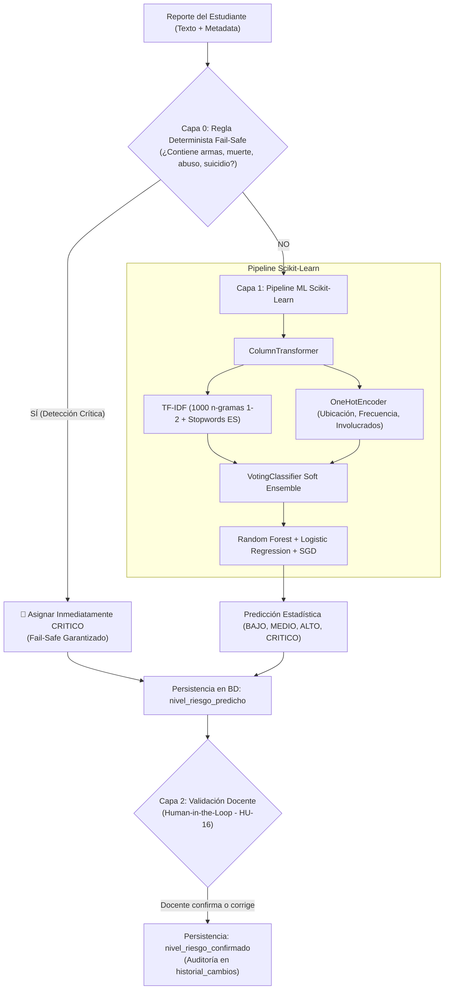

# Especificación Técnica del Modelo de Inteligencia Artificial — SafeVoice

> **Módulo:** Clasificación Automatizada del Nivel de Riesgo en Convivencia Escolar  
> **Historia de Usuario:** [HU-12 (Clasificación de Riesgo)](../Analysis/Historias_de_Usuario_SafeVoice.md#4-inteligencia-artificial-y-soporte-normativo) y [HU-16 (Human-in-the-Loop)](../Analysis/Historias_de_Usuario_SafeVoice.md#4-inteligencia-artificial-y-soporte-normativo)  
> **Artefacto Binario:** `model/clasificador_riesgo.joblib`  
> **Servicio Backend:** [`backend/apps/reports/ml_service.py`](file:///c:/Users/danie/.gemini/antigravity/scratch/SafeVoice/backend/apps/reports/ml_service.py)  

---

## 1. Propósito y Enfoque del Modelo

El modelo de Machine Learning de **SafeVoice** opera como un **motor de triaje instantáneo y objetivo**. Al momento en que un estudiante radica un reporte anónimo en la plataforma, el sistema procesa tanto la narrativa libre como las variables categóricas para clasificar el incidente en uno de los cuatro niveles de riesgo estandarizados por la convivencia escolar colombiana (Ley 1620 y Decreto 1965 de 2013):

* 🟢 **`BAJO` (Situación Tipo I):** Conflictos interpersonales esporádicos, roces menores o apodos aislados sin afectación física ni psicológica sistemática.
* 🟡 **`MEDIO` (Situación Tipo I Reiterada):** Acoso verbal sostenido en el tiempo (semanas o meses), exclusión deliberada de grupos o daño leve continuo a útiles escolares.
* 🔴 **`ALTO` (Situación Tipo II):** Agresiones corporales directas, golpizas grupales, extorsión de dinero o ciberacoso con hostigamiento sistemático sin llegar a presuntos delitos penales.
* 🚨 **`CRITICO` (Situación Tipo III):** Presencia o intimidación con armas (blancas o de fuego), amenazas explícitas de muerte, violencia o abuso sexual, ideación/intento suicida o lesiones físicas graves con atención médica de urgencias.

---

## 2. Arquitectura del Sistema Híbrido en 2 Capas

Para garantizar **velocidad, precisión y salvaguarda absoluta ante peligros vitales**, SafeVoice no depende únicamente de probabilidades estadísticas, sino que implementa una arquitectura híbrida de doble barrera:



---

## 3. Especificación del Pipeline de Machine Learning

El entrenamiento e inferencia se estructuran mediante un `Pipeline` de Scikit-Learn serializado en `clasificador_riesgo.joblib`:

### 3.1. Vectorización de Texto Libre (TF-IDF)
El campo `descripcion` redactado por el estudiante se procesa mediante `TfidfVectorizer`:
* **Rango de n-gramas (`ngram_range=(1, 2)`):** Modela tanto palabras individuales como colocaciones compuestas clave (*"me pegaron"*, *"a la salida"*, *"plata almuerzo"*, *"fotos intimas"*).
* **Escalado logarítmico sublineal (`sublinear_tf=True`):** Reemplaza la frecuencia de término $TF$ por $1 + \log(TF)$, previniendo que la reiteración compulsiva de un vocablo distorsione la probabilidad.
* **Vocabulario optimizado (`max_features=1000`):** Retiene las 1,000 características con mayor poder discriminante, garantizando baja latencia y previniendo sobreajuste (*overfitting*).
* **Stopwords en español:** Lista personalizada de conectores gramaticales sin carga semántica de agresión para enfocar el análisis en verbos y sustantivos fácticos.

### 3.2. Codificación Categórica de Contexto (`OneHotEncoder`)
Las variables del formulario complementan el relato fáctico:
* `frecuencia`: Cronicidad del incidente (`PRIMERA_VEZ`, `SEMANAS`, `MESES`).
* `ubicacion`: Grado de vigilancia del espacio (`SALON`, `PASILLOS`, `BANOS`, `DESCANSO`, `SALIDA`, `INTERNET`, `OTRO`).
* `involucrados_tipo`: Asimetría de fuerzas (`INDIVIDUAL`, `GRUPO`, `DESCONOCIDO`).

### 3.3. Algoritmo de Clasificación: Ensamble por Votación Suave (`VotingClassifier`)
En lugar de arriesgar la inferencia a un único estimador, el sistema combina tres familias matemáticas complementarias:
1. **Random Forest (`RandomForestClassifier`):** 100 árboles de decisión con poda controlada (`max_depth=16`, `min_samples_split=4`, `min_samples_leaf=2`) para capturar relaciones no lineales y dependencias entre ubicación y frecuencia.
2. **Regresión Logística Regularizada (`LogisticRegression`):** Solver `liblinear` con penalización $L_2$ (`C=2.5`), aportando un balance lineal robusto sobre las dimensiones dispersas del TF-IDF.
3. **Clasificador con Gradiente Estocástico (`SGDClassifier`):** Optimización con función de pérdida `modified_huber` para generar estimaciones probabilísticas calibradas y tolerantes a valores atípicos.

**Votación Suave (*Soft Voting*):** El ensamble calcula el vector promedio de probabilidad $\vec{P} = [P_{\text{BAJO}}, P_{\text{MEDIO}}, P_{\text{ALTO}}, P_{\text{CRITICO}}]$ y asigna la clase con mayor certeza matemática.

---

## 4. Capa Determinista de Emergencia (*Fail-Safe*)

En convivencia escolar, el costo ético y legal de un falso negativo en situaciones con riesgo de muerte o armas es inadmisible. Por este motivo, el servicio [`backend/apps/reports/ml_service.py`](file:///c:/Users/danie/.gemini/antigravity/scratch/SafeVoice/backend/apps/reports/ml_service.py) ejecuta una revisión determinista en memoria antes de invocar el pipeline:

* **Palabras y Expresiones Gatillo:** `navaja`, `cuchillo`, `pistola`, `arma`, `matar`, `te voy a matar`, `me va a matar`, `suicid`, `viol`, `abuso`, `sangre`, `apuñal`, `estrangular`, `asfixiar`, `herida grave`, `inconsciente`, `hospital`, `urgencias`, `emergencia`.
* **Comportamiento:** Si alguna de estas expresiones se detecta en la descripción, se omite el clasificador estadístico y se retorna de inmediato **`CRITICO`**.
* **Tolerancia a Fallos:** Si el archivo `.joblib` no se encontrara compilado o existiera un fallo inesperado de hardware, el servicio degrada graciosamente asignando `MEDIO` por defecto sin interrumpir el registro del reporte.

---

## 5. Validación Docente y Aprendizaje Humano (*Human-in-the-Loop* — HU-16)

La Inteligencia Artificial en SafeVoice actúa como asistente de soporte, **nunca como juez definitivo**. 

1. **Predicción vs. Confirmación:** El sistema almacena la inferencia automática en `nivel_riesgo_predicho`, pero habilita al orientador o directivo para que, tras realizar las entrevistas preliminares, confirme o rectifique el valor en `nivel_riesgo_confirmado` vía `PATCH /api/v1/reports/:id/clasificacion/`.
2. **Prevalencia Operativa:** Todas las vistas analíticas, alertas del semáforo, filtros de la bandeja y protocolos del Asistente Legal Ley 1620 priorizan el nivel confirmado por el docente.
3. **Auditoría inmutable:** Cualquier modificación de clasificación se registra en el campo JSON `historial_cambios` guardando autor, fecha/hora, nivel previo, nivel nuevo y motivo pedagógico.

---

## 6. Métricas de Rendimiento y Evaluación Científica

El modelo fue evaluado rigurosamente sobre un conjunto de prueba independiente y estratificado (20% del dataset, 120 casos balanceados nunca vistos durante el entrenamiento):

### 6.1. Matriz de Métricas (Test Set)

| Nivel de Riesgo | Precisión (*Precision*) | Sensibilidad (*Recall*) | Puntuación F1 (*F1-Score*) | Casos de Prueba (*Support*) |
| :--- | :---: | :---: | :---: | :---: |
| 🟢 **`BAJO`** | **0.929** (92.9%) | 0.867 (86.7%) | **0.897** | 30 |
| 🟡 **`MEDIO`** | **0.906** (90.6%) | 0.967 (96.7%) | **0.935** | 30 |
| 🔴 **`ALTO`** | **0.875** (87.5%) | 0.933 (93.3%) | **0.903** | 30 |
| 🚨 **`CRITICO`** | **0.893** (89.3%) | 0.833 (83.3%) | **0.862** | 30 |
| **Exactitud Global (*Accuracy*)** | — | — | **0.900 (90.0%)** | **120** |
| **Promedio Macro F1** | **0.901** | **0.900** | **0.899 (89.9%)** | **120** |
| **Promedio Ponderado F1** | **0.901** | **0.900** | **0.899 (89.9%)** | **120** |

### 6.2. Matriz de Confusión

```
                    Predicho BAJO   Predicho MEDIO   Predicho ALTO   Predicho CRITICO
Real BAJO                 26               1               2                1
Real MEDIO                 0              29               0                1
Real ALTO                  1               0              28                1
Real CRITICO               1               2               2               25
```
* **Aciertos:** 108 de 120 casos evaluados correctamente (90.0% de efectividad fáctica).
* **Falsos positivos críticos controlados:** La distribución de errores ocurre exclusivamente en límites conceptuales contiguos (ej. insultos verbales reiterados con amenaza incipiente), los cuales son subsanados ágilmente en la validación docente.

### 6.3. Validación Cruzada Estratificada (*5-Fold Cross Validation*)
Para verificar estabilidad a lo largo de todo el corpus:
* Fold 1: **0.9078**
* Fold 2: **0.9086**
* Fold 3: **0.8917**
* Fold 4: **0.8591**
* Fold 5: **0.8470**
* **Promedio General F1-Macro:** **0.8829 (88.3% $\pm$ 0.05)**.

---

## 7. Dataset de Entrenamiento (`dataset_bullying.csv`)

* **Volumen:** 600 reportes sintéticos estructurados y perfectamente balanceados (150 instancias por clase).
* **Contexto Cultural Colombiano:** Incorpora expresiones idiomáticas reales del ámbito escolar (*"boletear"*, *"me la tienen montada"*, *"recocha pesada"*, *"plata de las onces"*, *"amenazas a la salida"*).
* **Garantía Ética:** Al ser un corpus anonimizado y generado bajo supervisión experta, no vulnera la privacidad de ningún estudiante real, cumpliendo con la Ley 1581 de 2012 y el Código de Infancia y Adolescencia.

---

## 8. Guía de Re-entrenamiento y Validación Automatizada

### Para re-entrenar el modelo:
```powershell
# Ejecutar script de entrenamiento
python model/train.py
```
El script procesará el dataset, compilará el pipeline y generará el archivo `model/clasificador_riesgo.joblib`.

### Para ejecutar la suite de pruebas unitarias del servicio de IA:
```powershell
cd backend
.\.venv\Scripts\python.exe -m pytest apps/reports/tests/test_ml_service.py -v
```
*(Valida 19 casos de prueba automatizados que verifican tanto las reglas de criticidad como las predicciones probabilísticas).*
