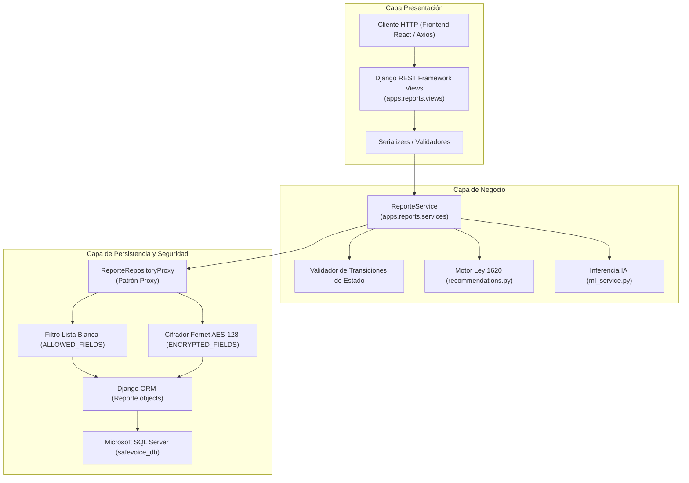

# Arquitectura de Software y Patrones de Seguridad — SafeVoice

> **Módulo:** Diseño de Arquitectura, Patrones de Seguridad y Protección de Datos  
> **Normativa de Referencia:** Ley 1581 de 2012 (Habeas Data) y Código de la Infancia y la Adolescencia (Ley 1098 de 2006)  
> **Archivos Clave:**  
> • [`backend/apps/reports/repository.py`](file:///c:/Users/danie/.gemini/antigravity/scratch/SafeVoice/backend/apps/reports/repository.py)  
> • [`backend/apps/reports/services.py`](file:///c:/Users/danie/.gemini/antigravity/scratch/SafeVoice/backend/apps/reports/services.py)  
> • [`backend/apps/reports/views.py`](file:///c:/Users/danie/.gemini/antigravity/scratch/SafeVoice/backend/apps/reports/views.py)  

---

## 1. Arquitectura en Tres Capas (Clean Architecture)

El backend de SafeVoice implementa una estricta separación de responsabilidades organizada en **tres capas desacopladas**:



### Reglas de Dependencia entre Capas:
1. **Views Delgadas (*Thin Controllers*):** Las vistas no contienen lógica de negocio ni interactúan jamás de forma directa con el ORM ni con el modelo `Reporte`. Su función se limita a deserializar peticiones, invocar al servicio de dominio y responder con códigos HTTP semánticos.
2. **Servicios de Dominio Orquestadores:** Toda regla de convivencia escolar (validación de transiciones de estado, aislamiento institucional *multi-tenant*, cálculo de riesgo y recomendaciones) reside exclusivamente en `ReporteService`.
3. **Persistencia Mediada por Proxy:** El servicio nunca llama directamente a `Reporte.objects.create()`. Todo acceso a la base de datos se delega obligatoriamente al `ReporteRepositoryProxy`.

---

## 2. Patrón de Diseño Proxy (`ReporteRepositoryProxy`)

Para dar cumplimiento formal al requisito **HU-05 (Protección Estructural del Anonimato)**, el sistema implementa el **Patrón Proxy** mediante la clase `ReporteRepositoryProxy`.

### 2.1. Lista Blanca de Campos Permitidos (`ALLOWED_FIELDS`)
El proxy actúa como una barrera inmutable que valida cualquier diccionario antes de tocar el motor ORM:

```python
ALLOWED_FIELDS: frozenset[str] = frozenset({
    "codigo_seguimiento",
    "institucion_id",
    "institucion",
    "ubicacion",
    "frecuencia",
    "grado_victima",
    "involucrados_tipo",
    "involucrados_grado",
    "descripcion",
    "evidencia_url",
    "tipos_agresion",
    "nivel_riesgo_predicho",
    "nivel_riesgo_confirmado",
    "nivel_riesgo",
    "estado",
    "rol_reportante",
    "fecha_aproximada",
    "acepta_revelar_identidad",
    "nombre_contacto_victima",
    "medio_contacto_victima",
    "historial_cambios",
})
```

* **Prevención de Inyección de Metadatos:** Si un atacante o un error futuro en un serializer intenta enviar campos identificables como `ip_address`, `user_agent`, `session_key` o `usuario_id`, el proxy detecta que no pertenecen a `ALLOWED_FIELDS` y aborta inmediatamente la transacción lanzando `ReporteCampoNoPermitidoError` antes de contactar a SQL Server.
* **Garantía Estructural:** Hace imposible que en la base de datos se vincule la identidad digital de un remitente con su reporte.

---

## 3. Cifrado en Reposo con Fernet (AES-128 en Modo CBC)

De conformidad con el Código de la Infancia y la Adolescencia (Ley 1098 de 2006) y la Ley Estatutaria de Protección de Datos Personales (Ley 1581 de 2012), los datos sensibles de los menores deben permanecer protegidos contra accesos no autorizados, incluso si existiera una extracción no autorizada del archivo de base de datos.

### 3.1. Campos Protegidos (`ENCRYPTED_FIELDS`)
```python
ENCRYPTED_FIELDS: frozenset[str] = frozenset({
    "descripcion",
    "nombre_contacto_victima",
    "medio_contacto_victima",
})
```

### 3.2. Mecanismo Criptográfico (Fernet)
* **Algoritmo:** Cifrado simétrico de clave de 128 bits mediante **AES en modo CBC** con autenticación de mensajes **HMAC-SHA256**.
* **Firma Criptográfica:** Cada campo cifrado inicia con el encabezado de versión `gAAAAA`, garantizando que cualquier manipulación o truncamiento en la base de datos sea detectado durante la desencriptación.
* **Gestión de Claves:** La clave simétrica de cifrado reside en la variable de entorno protegida `REPORTS_FERNET_KEY`. Nunca se almacena en el código fuente ni en el historial de Git.
* **Transparencia en Lectura y Escritura:**
  * Al guardar un reporte (`crear_reporte`): El proxy cifra automáticamente los campos en texto plano antes de persistirlos.
  * Al consultar un reporte (`obtener_por_id` / `listar_reportes`): El proxy descifra los campos en memoria para que los orientadores autenticados puedan analizarlos, sin alterar el estado cifrado en el disco del servidor.

---

## 4. Trazabilidad inmutable mediante Auditoría JSON (`historial_cambios`)

En lugar de crear múltiples tablas de auditoría fragmentadas, cada reporte almacena en el campo `historial_cambios` una bitácora cronológica inmutable con formato JSON:

```json
[
  {
    "fecha": "2026-10-27T14:35:10Z",
    "autor": "orientacion@colegio.edu.co",
    "tipo": "CAMBIO_ESTADO",
    "estado_anterior": "nuevo",
    "estado_nuevo": "en_seguimiento",
    "comentario": "Se activa acompañamiento preventivo en aula."
  },
  {
    "fecha": "2026-10-27T15:10:00Z",
    "autor": "orientacion@colegio.edu.co",
    "tipo": "VALIDACION_IA",
    "riesgo_ia_original": "MEDIO",
    "riesgo_confirmado": "ALTO",
    "comentario": "Se eleva el nivel tras constatar agresión verbal continuada y hostigamiento digital."
  },
  {
    "fecha": "2026-10-27T16:00:00Z",
    "autor": "rectoria@colegio.edu.co",
    "tipo": "RUTA_EXTERNA",
    "entidad": "ICBF",
    "radicado": "RAD-2026-9921",
    "comentario": "Remisión oficial ante el Centro Zonal para restitución de derechos."
  }
]
```

* **Inmutabilidad:** Cada acción agrega un nodo al arreglo sin sobreescribir los eventos anteriores.
* **Auditoría Legal:** Permite a directivos y secretarías de educación inspeccionar la línea de tiempo completa del debido proceso ante eventuales requerimientos judiciales.

---

## 5. Seguridad en Autenticación y Mitigación de Fuerza Bruta

### 5.1. Tokens JWT con Rotación Segura
* **Acceso:** `access_token` de corta duración para minimizar la ventana de exposición en caso de intercepción.
* **Refresco:** `refresh_token` con rotación automática (`ROTATE_REFRESH_TOKENS = True` en `settings.py`); cada vez que se renueva la sesión, se invalida el token de refresco previo.
* **Firma Criptográfica:** Firmado con algoritmo HMAC-SHA256 utilizando la `SECRET_KEY` institucional.

### 5.2. Mitigación contra Ataques de Fuerza Bruta (Throttling)
* El endpoint de autenticación `POST /api/v1/users/login/` implementa limitación de tasa específica (`throttle_scope = "login"`).
* Si una dirección IP o agente automatizado genera intentos fallidos repetidos, la API bloquea temporalmente las peticiones retornando `HTTP 429 Too Many Requests`.

---

## 6. Aislamiento Multi-Inquilino (*Multi-Tenancy* Lógico)

Para colegios independientes, la privacidad interinstitucional es crítica:
* Cada usuario (`Usuario`) y cada reporte (`Reporte`) están vinculados a una `institucion_id`.
* En la capa de servicios (`ReporteService.listar_reportes()`), todas las consultas aplican obligatoriamente el filtro `.filter(institucion=usuario.institution)`.
* Un orientador o directivo del *Colegio A* tiene imposibilidad matemática y lógica de consultar o filtrar incidentes pertenecientes al *Colegio B*.
