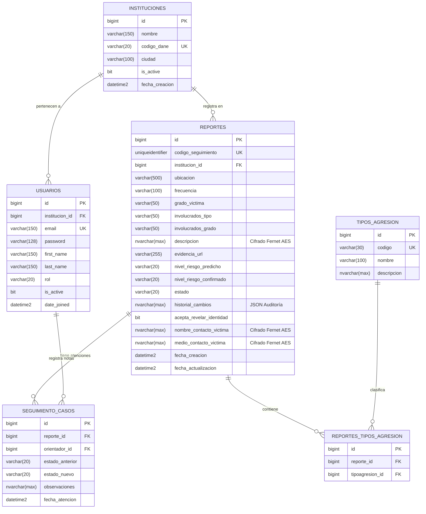

# Diseño de Base de Datos — SafeVoice

---

## 1. Principios de Arquitectura de Datos

1. **Anonimato Estructural Infalible:** La tabla `reportes` no contiene **ninguna clave foránea (`FK`) ni referencia** hacia la tabla `usuarios` ni hacia identidades estudiantiles. Es técnicamente imposible rastrear qué estudiante o dispositivo generó un reporte a partir del esquema de base de datos o de los registros persistidos.
2. **Cifrado en Reposo (Fernet / AES-128):** Los campos con potencial sensibilidad o revelación (`descripcion`, `nombre_contacto_victima`, `medio_contacto_victima`) son cifrados en reposo mediante el repositorio proxy antes de ser almacenados en el motor de base de datos, garantizando cumplimiento de la Ley de Protección de Datos Personales (Habeas Data).
3. **Trazabilidad y Auditoría Inmutable:** La tabla `reportes` incorpora el campo estructurado `historial_cambios` (JSON/NVARCHAR), que almacena la bitácora cronológica inmutable de transiciones de estado, validaciones docentes de IA, checklist del Asistente Legal Ley 1620, radicación de rutas externas y evaluaciones post-cierre.
4. **Motor de Persistencia de Producción:** El sistema opera en producción sobre **Microsoft SQL Server** (`safevoice_db`) alojado en la infraestructura de la nube, y utiliza **SQLite** en memoria para la ejecución aislada y de alto rendimiento de la suite de pruebas automatizadas (`pytest`).

---

## 2. Diagrama Entidad-Relación (ERD)



---

## 3. Diccionario de Datos

### 🏢 Tabla: `instituciones`
Almacena los colegios o instituciones educativas registradas en la plataforma. Es la unidad principal de aislamiento multi-inquilino (*multi-tenant* lógico).

| Campo | Tipo SQL Server | Django Model | Nulo | Descripción |
| :--- | :--- | :--- | :---: | :--- |
| `id` | `BIGINT IDENTITY` (PK) | `BigAutoField` | No | Identificador autoincremental primario. |
| `nombre` | `VARCHAR(150)` | `CharField` | No | Nombre oficial del colegio o institución educativa. |
| `codigo_dane` | `VARCHAR(20)` (UK) | `CharField` | Sí | Código DANE o NIT único de la institución. |
| `ciudad` | `VARCHAR(100)` | `CharField` | No | Municipio o ciudad de radicación (ej. Medellín). |
| `is_active` | `BIT` | `BooleanField` | No | Interruptor institucional (`1` = activa, `0` = suspendida). Default: `1`. |
| `fecha_creacion` | `DATETIME2` | `DateTimeField` | No | Marca de tiempo de registro en el sistema. |

---

### 👤 Tabla: `usuarios`
Usuarios institucionales autenticados con acceso al panel de gestión y análisis (Directivos y Orientadores). Extiende `AbstractUser` de Django.

| Campo | Tipo SQL Server | Django Model | Nulo | Descripción |
| :--- | :--- | :--- | :---: | :--- |
| `id` | `BIGINT IDENTITY` (PK) | `BigAutoField` | No | Identificador interno del usuario. |
| `institucion_id` | `BIGINT` (FK) | `ForeignKey` | Sí | Institución a la que pertenece el directivo u orientador. |
| `email` | `VARCHAR(254)` (UK) | `EmailField` | No | Correo institucional (identificador principal de inicio de sesión). |
| `password` | `VARCHAR(128)` | `CharField` | No | Hash criptográfico de la contraseña (PBKDF2 SHA-256). |
| `first_name` | `VARCHAR(150)` | `CharField` | No | Nombre(s) del usuario. |
| `last_name` | `VARCHAR(150)` | `CharField` | No | Apellidos del usuario. |
| `rol` | `VARCHAR(20)` | `CharField` | No | Rol del sistema: `'DIRECTIVO'`, `'ORIENTADOR'`. |
| `is_active` | `BIT` | `BooleanField` | No | Estado de la cuenta (`1` = activo, `0` = deshabilitado). |
| `is_staff` | `BIT` | `BooleanField` | No | Permiso para ingresar a la interfaz de administración Django. |
| `date_joined` | `DATETIME2` | `DateTimeField` | No | Fecha y hora de creación de la cuenta. |

---

### 📝 Tabla: `reportes`
Registros de incidentes creados de manera anónima por estudiantes (víctimas o testigos). Diseñada para garantizar estricta protección de identidad y auditoría integral.

| Campo | Tipo SQL Server | Django Model | Nulo | Descripción |
| :--- | :--- | :--- | :---: | :--- |
| `id` | `BIGINT IDENTITY` (PK) | `BigAutoField` | No | Identificador numérico primario de la fila. |
| `codigo_seguimiento` | `UNIQUEIDENTIFIER` (UK)| `UUIDField` | No | UUID v4 único e inmutable entregado al estudiante para consultar el caso sin revelar identidad. |
| `institucion_id` | `BIGINT` (FK) | `ForeignKey` | Sí | Colegio donde ocurrieron los hechos. |
| `ubicacion` | `VARCHAR(500)` | `CharField` | No | Lugares del incidente con soporte de **selección múltiple** (ej. `"Baños, Pasillos o escaleras, Salida del colegio"`). |
| `frecuencia` | `VARCHAR(100)` | `CharField` | No | Temporalidad: `"Pasó hoy o es la primera vez"`, `"Lleva pasando algunas semanas"`, `"Lleva pasando varios meses"`. |
| `grado_victima` | `VARCHAR(50)` | `CharField` | Sí | Nivel escolar de la persona afectada (ej. `"8°"`). |
| `involucrados_tipo` | `VARCHAR(50)` | `CharField` | Sí | Contexto de agresores: `"individual"`, `"grupo"`, `"desconocido"`. |
| `involucrados_grado` | `VARCHAR(50)` | `CharField` | Sí | Relación de aula: `"mismo_salon"`, `"mismo_grado"`, `"otro_grado"`. |
| `descripcion` | `NVARCHAR(MAX)` 🔒 | `TextField` | No | Relato del estudiante. **Cifrado en reposo con Fernet (AES-128)** por la capa Proxy. |
| `evidencia_url` | `VARCHAR(255)` | `CharField` | Sí | Ruta local o remota a la captura o fotografía adjunta opcional. |
| `nivel_riesgo_predicho`| `VARCHAR(20)` | `CharField` | Sí | Resultado predictivo del modelo IA NLP / Reglas críticas: `'BAJO'`, `'MEDIO'`, `'ALTO'`, `'CRITICO'`. |
| `nivel_riesgo_confirmado`| `VARCHAR(20)`| `CharField` | Sí | Nivel verificado o corregido manualmente por el orientador. Prevalece sobre el predicho. |
| `estado` | `VARCHAR(20)` | `CharField` | No | Ciclo de vida: `'nuevo'`, `'en_revision'`, `'en_seguimiento'`, `'cerrado'`, `'reabierto'`. |
| `historial_cambios` | `NVARCHAR(MAX)` | `JSONField` | No | Estructura JSON con el histórico de auditoría: cambios de estado, notas docentes, checklist Ley 1620, radicado de ruta externa y evaluaciones post-cierre. |
| `acepta_revelar_identidad`| `BIT` | `BooleanField` | No | `1` si el estudiante aceptó compartir datos de contacto voluntariamente; `0` si es estrictamente anónimo. |
| `nombre_contacto_victima`| `NVARCHAR(MAX)` 🔒| `TextField` | Sí | Nombre voluntario. **Cifrado en reposo con Fernet (AES-128)**. |
| `medio_contacto_victima` | `NVARCHAR(MAX)` 🔒| `TextField` | Sí | Teléfono o correo voluntario. **Cifrado en reposo con Fernet (AES-128)**. |
| `fecha_creacion` | `DATETIME2` | `DateTimeField` | No | Fecha y hora exacta de radicación del reporte (`auto_now_add=True`). |
| `fecha_actualizacion`| `DATETIME2` | `DateTimeField` | No | Fecha y hora del último cambio (`auto_now=True`). |

> 🔒 **Nota de Seguridad:** Los campos marcados con el candado se almacenan como cadenas cifradas en base64 generadas por Fernet (`cryptography.fernet.Fernet`). En caso de acceso no autorizado directo a la base de datos, el contenido es ilegible sin la clave maestra `REPORTS_FERNET_KEY`.

---

### 🏷️ Tabla: `tipos_agresion`
Catálogo estructurado de las modalidades de acoso y agresión escolar tipificadas en el sistema.

| Campo | Tipo SQL Server | Django Model | Nulo | Descripción |
| :--- | :--- | :--- | :---: | :--- |
| `id` | `BIGINT IDENTITY` (PK) | `BigAutoField` | No | Identificador primario. |
| `codigo` | `VARCHAR(30)` (UK) | `CharField` | No | Clave técnica única: `FISICO`, `VERBAL`, `PSICOLOGICO_SOCIAL`, `CIBERBULLYING`, `MATERIAL`. |
| `nombre` | `VARCHAR(100)` | `CharField` | No | Nombre descriptivo amigable. |
| `descripcion` | `NVARCHAR(MAX)` | `TextField` | Sí | Explicación pedagógica de la conducta. |

---

### 🔗 Tabla Intermedia: `reportes_tipos_agresion`
Tabla de unión Many-to-Many entre los reportes y las modalidades de agresión detectadas o seleccionadas.

| Campo | Tipo SQL Server | Django Model | Nulo | Descripción |
| :--- | :--- | :--- | :---: | :--- |
| `id` | `BIGINT IDENTITY` (PK) | `BigAutoField` | No | Clave primaria técnica de la tabla intermedia. |
| `reporte_id` | `BIGINT` (FK) | `ForeignKey` | No | Referencia al reporte asociado (`ON DELETE CASCADE`). |
| `tipoagresion_id`| `BIGINT` (FK) | `ForeignKey` | No | Referencia al tipo de agresión (`ON DELETE CASCADE`). |

---

### 📋 Tabla: `seguimiento_casos`
Bitácora formal de atención pedagógica y psicosocial diligenciada por el docente u orientador.

| Campo | Tipo SQL Server | Django Model | Nulo | Descripción |
| :--- | :--- | :--- | :---: | :--- |
| `id` | `BIGINT IDENTITY` (PK) | `BigAutoField` | No | Identificador único de la atención. |
| `reporte_id` | `BIGINT` (FK) | `ForeignKey` | No | Caso atendido (`ON DELETE CASCADE`). |
| `orientador_id` | `BIGINT` (FK) | `ForeignKey` | Sí | Funcionario orientador que registró la intervención. |
| `estado_anterior` | `VARCHAR(20)` | `CharField` | Sí | Estado del caso antes de la atención. |
| `estado_nuevo` | `VARCHAR(20)` | `CharField` | No | Estado resultante asignado tras la sesión. |
| `observaciones` | `NVARCHAR(MAX)` | `TextField` | No | Notas detalladas de las acciones tomadas o compromisos pactados. |
| `fecha_atencion` | `DATETIME2` | `DateTimeField` | No | Fecha y hora del registro de atención. |

---

## 4. Script DDL para Microsoft SQL Server (T-SQL)

Script de creación directa y compatible con Microsoft SQL Server 2017+ / Azure SQL Database:

```sql
-- 1. Tabla de Instituciones Educativas
CREATE TABLE instituciones (
    id BIGINT IDENTITY(1,1) PRIMARY KEY,
    nombre VARCHAR(150) NOT NULL,
    codigo_dane VARCHAR(20) NULL CONSTRAINT uq_institucion_codigo_dane UNIQUE,
    ciudad VARCHAR(100) NOT NULL,
    is_active BIT DEFAULT 1 NOT NULL,
    fecha_creacion DATETIME2 DEFAULT SYSDATETIME() NOT NULL
);

-- 2. Tabla de Usuarios (Orientadores y Directivos)
CREATE TABLE usuarios (
    id BIGINT IDENTITY(1,1) PRIMARY KEY,
    institucion_id BIGINT NULL CONSTRAINT fk_usuarios_institucion REFERENCES instituciones(id),
    email VARCHAR(254) NOT NULL CONSTRAINT uq_usuarios_email UNIQUE,
    password VARCHAR(128) NOT NULL,
    first_name VARCHAR(150) NOT NULL DEFAULT '',
    last_name VARCHAR(150) NOT NULL DEFAULT '',
    rol VARCHAR(20) NOT NULL CONSTRAINT ck_usuarios_rol CHECK (rol IN ('DIRECTIVO', 'ORIENTADOR')),
    is_active BIT DEFAULT 1 NOT NULL,
    is_staff BIT DEFAULT 0 NOT NULL,
    is_superuser BIT DEFAULT 0 NOT NULL,
    date_joined DATETIME2 DEFAULT SYSDATETIME() NOT NULL,
    last_login DATETIME2 NULL
);

-- 3. Tabla Catálogo de Tipos de Agresión
CREATE TABLE tipos_agresion (
    id BIGINT IDENTITY(1,1) PRIMARY KEY,
    codigo VARCHAR(30) NOT NULL CONSTRAINT uq_tipos_agresion_codigo UNIQUE,
    nombre VARCHAR(100) NOT NULL,
    descripcion NVARCHAR(MAX) NULL
);

-- Semilla de datos iniciales para tipos de agresión
INSERT INTO tipos_agresion (codigo, nombre, descripcion) VALUES
('FISICO', 'Acoso Físico', 'Empujones, golpes, agresiones corporales o lesiones.'),
('VERBAL', 'Acoso Verbal', 'Insultos, apodos ofensivos, burlas constantes o gritos.'),
('PSICOLOGICO_SOCIAL', 'Acoso Psicológico / Social', 'Exclusión forzada, amenazas, propagación de rumores o humillación.'),
('CIBERBULLYING', 'Ciberacoso / Ciberbullying', 'Hostigamiento mediante WhatsApp, redes sociales, memes o difusión de imágenes no autorizadas.'),
('MATERIAL', 'Daño Material / Hurto', 'Sustracción, daño, ocultamiento o destrucción de útiles y pertenencias personales.');

-- 4. Tabla de Reportes Anónimos y Confidenciales
CREATE TABLE reportes (
    id BIGINT IDENTITY(1,1) PRIMARY KEY,
    codigo_seguimiento UNIQUEIDENTIFIER NOT NULL DEFAULT NEWID() CONSTRAINT uq_reportes_codigo_seguimiento UNIQUE,
    institucion_id BIGINT NULL CONSTRAINT fk_reportes_institucion REFERENCES instituciones(id) ON DELETE CASCADE,
    ubicacion VARCHAR(500) NOT NULL DEFAULT '',
    frecuencia VARCHAR(100) NOT NULL DEFAULT '',
    grado_victima VARCHAR(50) NULL,
    involucrados_tipo VARCHAR(50) NULL,
    involucrados_grado VARCHAR(50) NULL,
    descripcion NVARCHAR(MAX) NOT NULL, -- Cifrado con Fernet AES-128
    evidencia_url VARCHAR(255) NULL,
    nivel_riesgo_predicho VARCHAR(20) NULL CONSTRAINT ck_reportes_riesgo_pred CHECK (nivel_riesgo_predicho IN ('BAJO', 'MEDIO', 'ALTO', 'CRITICO')),
    nivel_riesgo_confirmado VARCHAR(20) NULL CONSTRAINT ck_reportes_riesgo_conf CHECK (nivel_riesgo_confirmado IN ('BAJO', 'MEDIO', 'ALTO', 'CRITICO')),
    estado VARCHAR(20) NOT NULL DEFAULT 'nuevo' CONSTRAINT ck_reportes_estado CHECK (estado IN ('nuevo', 'en_revision', 'en_seguimiento', 'cerrado', 'reabierto', 'PENDIENTE', 'ATENDIDO', 'DESCARTADO')),
    historial_cambios NVARCHAR(MAX) NOT NULL DEFAULT '[]', -- Auditoría JSON
    acepta_revelar_identidad BIT NOT NULL DEFAULT 0,
    nombre_contacto_victima NVARCHAR(MAX) NULL, -- Cifrado con Fernet AES-128
    medio_contacto_victima NVARCHAR(MAX) NULL, -- Cifrado con Fernet AES-128
    fecha_creacion DATETIME2 NOT NULL DEFAULT SYSDATETIME(),
    fecha_actualizacion DATETIME2 NOT NULL DEFAULT SYSDATETIME()
);

-- 5. Tabla Intermedia Many-to-Many Reportes - Tipos de Agresión
CREATE TABLE reportes_tipos_agresion (
    id BIGINT IDENTITY(1,1) PRIMARY KEY,
    reporte_id BIGINT NOT NULL CONSTRAINT fk_rta_reporte REFERENCES reportes(id) ON DELETE CASCADE,
    tipoagresion_id BIGINT NOT NULL CONSTRAINT fk_rta_tipoagresion REFERENCES tipos_agresion(id) ON DELETE CASCADE,
    CONSTRAINT uq_reporte_tipoagresion UNIQUE (reporte_id, tipoagresion_id)
);

-- 6. Tabla Bitácora de Seguimiento de Casos
CREATE TABLE seguimiento_casos (
    id BIGINT IDENTITY(1,1) PRIMARY KEY,
    reporte_id BIGINT NOT NULL CONSTRAINT fk_sc_reporte REFERENCES reportes(id) ON DELETE CASCADE,
    orientador_id BIGINT NULL CONSTRAINT fk_sc_orientador REFERENCES usuarios(id),
    observaciones NVARCHAR(MAX) NOT NULL DEFAULT '',
    estado_anterior VARCHAR(20) NULL,
    estado_nuevo VARCHAR(20) NOT NULL,
    fecha_atencion DATETIME2 NOT NULL DEFAULT SYSDATETIME()
);

-- Índices optimizados para consultas del panel y mapa de calor
CREATE NONCLUSTERED INDEX ix_reportes_institucion_estado ON reportes (institucion_id, estado);
CREATE NONCLUSTERED INDEX ix_reportes_fecha_creacion ON reportes (fecha_creacion DESC);
CREATE NONCLUSTERED INDEX ix_reportes_riesgo ON reportes (nivel_riesgo_confirmado, nivel_riesgo_predicho);
```
